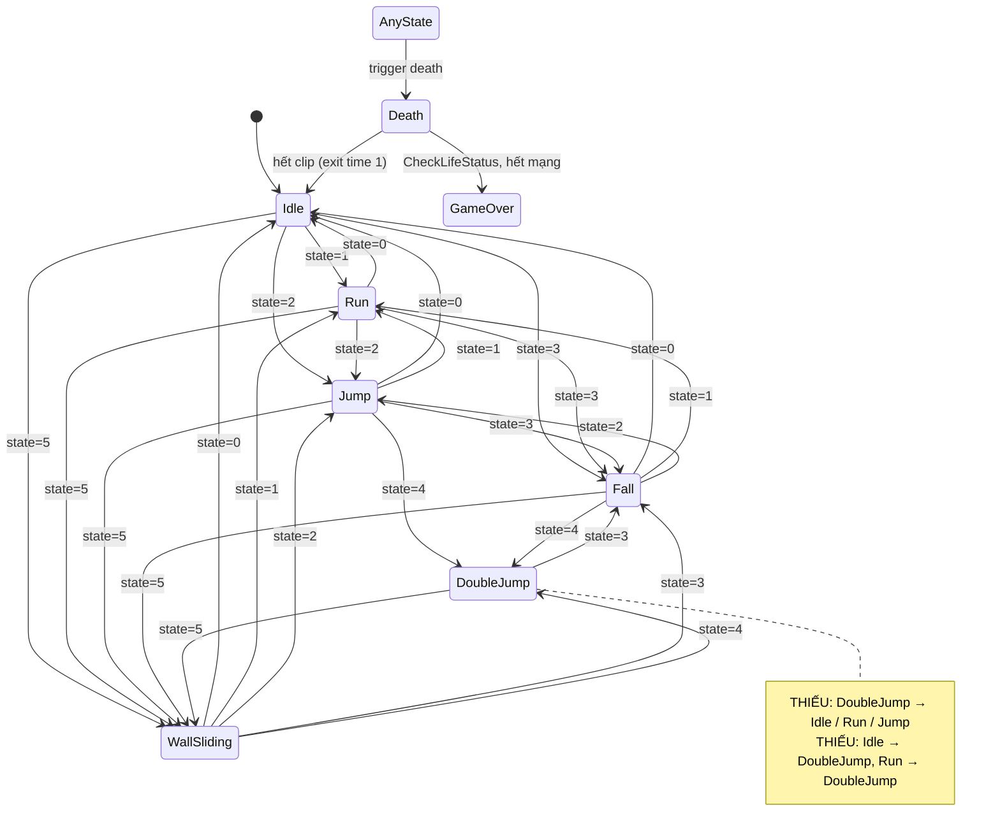

# Báo cáo kiểm thử trạng thái Player và Animation

| | |
|---|---|
| Dự án | Dungeon Escape 2D |
| Task Jira | P1-5/P1-31 – Kiểm thử trạng thái Player và Animation |
| Kỹ thuật | State Transition Testing (0-switch coverage, chuyển không hợp lệ, kẹt trạng thái) |
| Phạm vi | `PlayerMovement.cs`, `PlayerLife.cs`, `PauseManager.cs`, `GameOverMenu.cs`, Animator Controller của 4 nhân vật đang dùng (VirtualGuy, PinkMan, NinjaFrog, MaskDude) |
| Test tự động | `Assets/Tests/PlayMode/PlayerStateTests.cs` (21 test, TC-ST-01 … TC-ST-21) |
| Môi trường | Windows 11 (10.0.26200), Unity 6000.3.6f1, Unity Test Framework 1.6.0, Input System 1.18.0, PlayMode batchmode |
| Phiên bản | Nhánh `testing-v2`, commit `287e4c9` |
| Ngày chạy | 04/11/2026 – chạy 3 lần liên tiếp, kết quả giống nhau |
| Kết quả | **21 test: 12 Đạt, 9 Không đạt.** Cả 9 test không đạt đều do lỗi của game (9 lỗi, mục 5) |

`CaptainClown.controller` không thuộc phạm vi, vì không nhân vật nào trong `CharacterData.asset` dùng controller này.

## 1. Mô hình trạng thái

PlayerMovement tính lại tham số Int `state` của Animator ở **mỗi frame** ([PlayerMovement.cs:312-353](../../Assets/Scripts/Player/PlayerMovement.cs#L312-L353)). Giá trị được chọn theo thứ tự ưu tiên sau:

1. Bám tường và không chạm đất → `5` WallSliding. Chỉ xảy ra với nhân vật có `canWallGrab`, tức MaskDude.
2. Nếu `canMove`:
   - `dirX ≠ 0` → `1` Run, ngược lại → `0` Idle.
   - Sau đó xét vận tốc dọc: `v.y > 0,1` → `2` Jump (khi `airJumpCnt = 0`) hoặc `4` DoubleJump; `v.y < −0,1` → `3` Fall.
3. Nếu `!canMove` (0,15 s sau wall jump) → giữ mặc định `0`.

`Death` không đi qua tham số `state`. Nó là transition từ Any State với trigger `death`, do `PlayerLife.Die()` đặt. Death → Idle chạy khi hết clip (1,83 s). Animation Event `CheckLifeStatus` ở cuối clip sẽ hồi sinh Player hoặc mở Game Over.

### 1.1 Sơ đồ trạng thái (Animator Controller hiện tại)

Các mũi tên dưới đây là transition **đang có** trong VirtualGuy, PinkMan và MaskDude. Mọi transition đều có Has Exit Time = không, trừ Death → Idle.



NinjaFrog giống sơ đồ trên, nhưng transition WallSliding → Fall có điều kiện **`state=4`** thay vì `state=3`.

### 1.2 Bảng chuyển trạng thái hợp lệ

| Trạng thái hiện tại | Sự kiện / điều kiện | Trạng thái tiếp theo | Test |
|---|---|---|---|
| Idle | Giữ A hoặc D | Run | TC-ST-01, 10 |
| Run | Thả phím; hoặc giữ cả A và D | Idle | TC-ST-01, 11 |
| Idle | Bấm Space trên đất | Jump | TC-ST-02 |
| Run | Bấm Space trên đất | Jump | TC-ST-03 |
| Run | Chạy ra khỏi mép, v.y < −0,1 | Fall | TC-ST-05 |
| Jump | v.y < −0,1 | Fall | TC-ST-02 |
| Jump / Fall | Bấm Space trên không, `airJumpCnt < maxAirJumpCnt` | DoubleJump | TC-ST-04 |
| DoubleJump | v.y < −0,1 | Fall | TC-ST-04 |
| Fall | Tiếp đất, không giữ phím | Idle | TC-ST-02, 04, 05 |
| Fall | Tiếp đất, đang giữ D | Run | TC-ST-03 |
| Fall | Chạm tường, không chạm đất (MaskDude) | WallSliding | TC-ST-06 |
| WallSliding | Trượt tới đất | Idle | TC-ST-06 |
| WallSliding | Bấm Space (wall jump) | Jump | TC-ST-07 |
| Bất kỳ | Chạm bẫy hoặc enemy (`Die()`) | Death | TC-ST-08, 09, 10 |
| Death | Hết clip, còn mạng | Idle (hồi sinh) | TC-ST-08, 09, 20, 21 |
| Death | Hết clip, hết mạng | Game Over (timeScale = 0) | TC-ST-17 |
| Mọi cặp (state nguồn × giá trị state mới) | Đặt tham số `state` | Animation tương ứng | TC-ST-10 |

### 1.3 Bảng chuyển không hợp lệ (không được xảy ra)

| Trạng thái | Sự kiện | Không được chuyển thành | Test | Kết quả |
|---|---|---|---|---|
| Idle trên đất | Không bấm gì trong 2 s | Fall / Jump, hoặc trôi | TC-ST-18 | Đạt |
| Nhân vật không có wall grab, trên không | Áp vào tường | WallSliding | TC-ST-19 | Đạt |
| Death | `state` đổi (Jump/Fall) trước khi hết clip | Rời Death | TC-ST-09, 10 | Đạt |
| Death | Bấm D | Di chuyển ngang | TC-ST-15 | **Không đạt** |
| Bay lên sau wall jump | 0,15 s đầu | Idle / Run | TC-ST-07 | **Không đạt** |
| Bị tường chặn trên đất | Giữ D | Run | TC-ST-12 | **Không đạt** |
| Trên không, áp tường, không có wall grab | Giữ D | Đứng yên trên không | TC-ST-13 | **Không đạt** |
| Đứng trên đất sau DoubleJump | `state = 0` | Vẫn ở DoubleJump | TC-ST-14 | **Không đạt** |
| Pause khi đang nhảy | Bấm Space | Nhảy thêm / đổi trạng thái | TC-ST-16 | Đạt |
| Game Over | Bấm P hai lần | Game chạy tiếp | TC-ST-17 | **Không đạt** |
| Vừa hồi sinh trên đất | – | Fall | TC-ST-20 | **Không đạt** |

## 2. Cách kiểm thử

**Kiểm tra cả Animator lẫn vật lý.** Mỗi test kiểm tra hai phía:
- Animator: tham số `state` và state đang chạy, bằng `GetCurrentAnimatorStateInfo(0).IsName`.
- Vật lý: vận tốc và vị trí của Rigidbody2D.

TC-ST-10 là ngoại lệ, chỉ kiểm tra cấu hình Animator (xem bảng ở mục 3).

**Sân thử riêng.** Các test chuyển động dựng sàn và tường bằng BoxCollider2D trên layer Ground, đặt ở x ≈ 1000, y = 300, xa map Level1. Nhờ vậy kết quả không phụ thuộc thiết kế màn. Các object này chỉ được tạo lúc chạy test.

**Chống treo.** Mỗi test có `[Timeout]`. Mọi chỗ chờ đều có giới hạn thời gian và được đo bằng đồng hồ thực.

**Không sửa file game.** Các thao tác sau chỉ áp dụng trong lúc chạy test, trên object đang có trong scene:
- Hủy nút cảm ứng ảo.
- Ghép PlayerInput cố định với bàn phím ảo.
- Tắt PlayerMovement trong TC-ST-10.

### Lỗi của môi trường test đã sửa trong quá trình viết test (không phải lỗi game)

1. **Gọi `Press`/`Release` ngay sau `WaitForFixedUpdate`.** Lúc này Input System đang ở ngữ cảnh fixed-update, và project không cấp bộ đệm cho ngữ cảnh này nên báo lỗi "does not have an associated state". Cách sửa: luôn chờ thêm 1 frame thường.
2. **PlayerInput tự chuyển scheme.** Nút cảm ứng ảo tạo một Gamepad ảo, khiến PlayerInput tự chuyển qua lại giữa scheme Gamepad và Keyboard&Mouse, làm mất phím bấm giả lập. Cách sửa:
   - Hủy nút cảm ứng, giống TC_UI_03.
   - Ghép PlayerInput với bàn phím ảo.
   - Kiểm tra phím đã tới game (qua `dirX` hoặc số lần action được kích hoạt). Nếu chưa, nhấn lại, tối đa 3 lần.
3. **Hàm chờ dựa trên `unscaledDeltaTime` hết giờ quá sớm.** Một frame bị khựng lâu làm vòng chờ kết thúc ngay. Cách sửa: dùng đồng hồ thực và chờ tối thiểu 10 frame.

## 3. Danh sách test case và kết quả

| ID | Test | Loại | Kết quả | Lỗi |
|---|---|---|---|---|
| TC-ST-01 | Idle → Run → Idle (giữ / thả D) | Hợp lệ | Đạt | |
| TC-ST-02 | Idle → Jump → Fall → Idle | Hợp lệ | Đạt | |
| TC-ST-03 | Run → Jump → tiếp đất khi giữ D → Run | Hợp lệ | Đạt | |
| TC-ST-04 | PinkMan: Jump → DoubleJump → Fall → Idle | Hợp lệ | Đạt | |
| TC-ST-05 | Run → chạy khỏi mép → Fall → Idle | Hợp lệ | Đạt | |
| TC-ST-06 | MaskDude: Fall → WallSliding → Idle | Hợp lệ | Đạt | |
| TC-ST-07 | MaskDude: wall jump không hiện Idle giữa không trung | Kẹt | **Không đạt** | BUG-ST-03 |
| TC-ST-08 | Death → hồi sinh → Idle, trừ 1 mạng | Hợp lệ | Đạt | |
| TC-ST-09 | Chết khi đang nhảy; Death giữ tới hết clip | Hợp lệ + không hợp lệ | Đạt | |
| TC-ST-10 | Ma trận 0-switch trên Animator của 4 nhân vật (chỉ Animator) | Hợp lệ | **Không đạt** (21 cặp sai) | BUG-ST-01, BUG-ST-02 |
| TC-ST-11 | Bấm A + D cùng lúc | Input xung đột | Đạt | |
| TC-ST-12 | Chạy vào tường trên đất | Kẹt | **Không đạt** | BUG-ST-05 |
| TC-ST-13 | Nhảy áp tường khi giữ D | Kẹt | **Không đạt** | BUG-ST-04 |
| TC-ST-14 | Tiếp đất khi đang DoubleJump | Kẹt | **Không đạt** | BUG-ST-01 |
| TC-ST-15 | Bấm D trong lúc chết | Không hợp lệ | **Không đạt** | BUG-ST-06 |
| TC-ST-16 | Pause khi đang nhảy | Kẹt | Đạt | |
| TC-ST-17 | Game Over rồi bấm P hai lần | Kẹt | **Không đạt** | BUG-ST-07 |
| TC-ST-18 | Đứng yên 2 s | Không hợp lệ | Đạt | |
| TC-ST-19 | VirtualGuy áp tường không vào WallSliding | Không hợp lệ | Đạt | |
| TC-ST-20 | Hồi sinh: reset vận tốc, không nháy Fall | Kẹt | **Không đạt** | BUG-ST-08 |
| TC-ST-21 | Hồi sinh khi chưa qua checkpoint đúng điểm bắt đầu màn | Hợp lệ | **Không đạt** | BUG-ST-09 |

**Chi tiết từng bước, dữ liệu đầu vào và kết quả thực tế:** xem nhóm "Player-State" trong `Docs/Testing/TestCases.xlsx`.

**File kết quả gốc:** `TestResults/playerstate-results.xml`.

**Cách chạy lại** (cần đóng Unity Editor trước):

```bat
"C:\Program Files\Unity\Hub\Editor\6000.3.6f1\Editor\Unity.exe" -batchmode -projectPath . -runTests -testPlatform PlayMode ^
  -testFilter DungeonEscape.Tests.PlayerStateTests -testResults TestResults\playerstate-results.xml -logFile TestResults\playerstate-unity.log
```

## 4. Tổng hợp lỗi

| ID | Tóm tắt | Mức độ | Test phát hiện |
|---|---|---|---|
| BUG-ST-01 | Animator thiếu transition DoubleJump → Idle/Run/Jump và Idle/Run → DoubleJump | Major | TC-ST-10, TC-ST-14 |
| BUG-ST-02 | NinjaFrog: WallSliding → Fall có điều kiện `state=4` | Minor (lỗi ẩn) | TC-ST-10 |
| BUG-ST-03 | Sau wall jump hiện Idle giữa không trung 0,15 s | Minor | TC-ST-07 |
| BUG-ST-04 | Nhân vật không có wall grab bị dính tường khi giữ phím hướng vào tường | Major | TC-ST-13 |
| BUG-ST-05 | Bị tường chặn nhưng vẫn ở animation Run | Minor | TC-ST-12 |
| BUG-ST-06 | Vẫn điều khiển di chuyển được trong lúc chết | Major | TC-ST-15 |
| BUG-ST-07 | Game Over, bấm P hai lần thì game chạy tiếp | Major | TC-ST-17 |
| BUG-ST-08 | Respawn không reset vận tốc, animator nháy Fall | Minor | TC-ST-20 |
| BUG-ST-09 | Level1: hồi sinh cách điểm bắt đầu màn 57,8 đơn vị | Major | TC-ST-21 |

**Thang mức độ:**
- **Major:** ảnh hưởng lối chơi, hoặc làm game sai trạng thái.
- **Minor:** chủ yếu là lỗi hiển thị, hoặc là lỗi ẩn.

## 5. Chi tiết các lỗi kẹt trạng thái

### BUG-ST-01 – Animation DoubleJump bị kẹt; không vào được DoubleJump từ Idle/Run

**Mô tả.** Lỗi nằm trong cả 4 Animator Controller:
- State DoubleJump chỉ có transition tới Fall (`state=3`) và WallSliding (`state=5`).
- Idle và Run không có transition tới DoubleJump (`state=4`).

**Hậu quả.** Nếu Player chạm đất khi vẫn đang đi lên sau nhảy đôi (ví dụ vướng mép platform), animator kẹt ở DoubleJump trong lúc đứng, chạy và cả khi nhảy lại, cho tới khi rơi xuống. Ngược lại, nếu đang hiện Idle giữa không trung (BUG-ST-03) mà nhảy đôi, animation vẫn là Idle.

**Cách tái hiện.**
- TC-ST-14: PinkMan nhảy rồi nhảy đôi; trong lúc v.y > 0, đặt lại Player đứng trên sàn. Kết quả: `state = 0`, v = 0, nhưng animator vẫn ở DoubleJump.
- TC-ST-10: báo 20 cặp sai, gồm 5 cặp × 4 nhân vật.

**Mức độ:** Major.

**File nghi vấn:** state DoubleJump và Idle/Run trong `Assets/Animations/Player/{VirtualGuy,PinkMan,NinjaFrog,MaskDude}/*.controller`.

**Đề xuất sửa.** Thêm các transition sau, cùng cấu hình với các transition hiện có (Has Exit Time = không, duration = 0):
- DoubleJump → Idle (`state=0`), DoubleJump → Run (`state=1`), DoubleJump → Jump (`state=2`).
- Idle → DoubleJump (`state=4`), Run → DoubleJump (`state=4`).

Cách khác: chuyển các transition locomotion sang dùng Any State, với Can Transition To Self = không.

### BUG-ST-02 – NinjaFrog: WallSliding → Fall sai điều kiện

**Mô tả.** Trong `NinjaFrog.controller`, transition WallSliding → Fall có điều kiện `state Equals 4`. Các controller khác dùng `state Equals 3`. Hậu quả:
- Rời tường để rơi xuống (`state=3`) thì animation kẹt ở WallSliding.
- `state=4` lại đi vào Fall thay vì DoubleJump.

**Cách tái hiện.** Trong TC-ST-10, NinjaFrog với WallSliding + `state=3` vẫn ở WallSliding.

**Mức độ:** Minor. Hiện NinjaFrog có `canWallGrab = false` nên người chơi chưa gặp lỗi này, nhưng sẽ kẹt ngay khi bật wall grab cho NinjaFrog.

**File nghi vấn:** `Assets/Animations/Player/NinjaFrog/NinjaFrog.controller`, transition WallSliding → Fall.

**Đề xuất sửa:** đổi điều kiện thành `state Equals 3`.

### BUG-ST-03 – Hiện Idle giữa không trung sau wall jump

**Mô tả.** `WallJump()` tắt `canMove` trong 0,15 s. Trong `UpdateAnimationState()`, mọi phép xét vận tốc nằm trong `if (canMove)`, nên `state` giữ giá trị mặc định 0 (Idle) dù Player đang bay lên với v = (−15; 14,4).

**Cách tái hiện (TC-ST-07).**
1. MaskDude trượt tường.
2. Bấm Space.

Kết quả: khoảng 150 frame (≈ 0,15 s) animator ở Idle khi đang bay.

**Mức độ:** Minor (hiển thị). Lỗi này còn kết hợp với BUG-ST-01: nếu nhảy đôi trong 0,15 s đó thì animation kẹt ở Idle.

**File nghi vấn:** [PlayerMovement.cs:314](../../Assets/Scripts/Player/PlayerMovement.cs#L314) (`state = MovementState.idle`) và [PlayerMovement.cs:322](../../Assets/Scripts/Player/PlayerMovement.cs#L322) (`if (canMove)`).

**Đề xuất sửa.** Đưa phần xét `rb.linearVelocity.y` (dòng 341–348) ra ngoài `if (canMove)`, để trạng thái trên không luôn được tính theo vận tốc. `canMove` chỉ nên ảnh hưởng tới Run/Idle và hướng sprite.

### BUG-ST-04 – Bị dính tường khi giữ phím hướng vào tường

**Mô tả.**
- `Move()` đặt `v.x = dirX × moveSpeed` ở mỗi FixedUpdate, nên khi giữ phím Player liên tục bị đẩy vào tường.
- Project không có PhysicsMaterial2D nào: collider của Player, Terrain và `Physics2DSettings.m_DefaultMaterial` đều không gán. Vì vậy ma sát mặc định là 0,4.
- Lực ma sát với tường đủ lớn để triệt tiêu trọng lực, khiến Player **treo trên tường**. Animator lúc đó ở Run giữa không trung.

Lỗi này xảy ra với mọi nhân vật không có wall grab, và có thể bị lợi dụng để bám tường.

**Cách tái hiện (TC-ST-13).**
1. VirtualGuy áp sát tường, giữ D.
2. Bấm Space.

Kết quả: sau 3 s Player vẫn treo ở độ cao 0,46 trên sàn, v = (0; 0), đứng yên 2,94 s.

**Mức độ:** Major.

**File nghi vấn:** [PlayerMovement.cs:261](../../Assets/Scripts/Player/PlayerMovement.cs#L261). BoxCollider2D của các prefab trong `Assets/Prefabs/Characters/` có `m_Material: {fileID: 0}`.

**Đề xuất sửa.** Chọn một trong hai cách:
- Tạo một PhysicsMaterial2D với Friction = 0, rồi gán cho collider hoặc Rigidbody2D của Player. Cách này phổ biến cho nhân vật platformer.
- Khi không chạm đất, không đặt `v.x` hướng vào tường đang chạm.

### BUG-ST-05 – Bị tường chặn nhưng vẫn ở Run

**Mô tả.** State Run được chọn theo `dirX` (phím đang giữ), không theo vận tốc thật. Khi bị tường chặn, Player đứng yên nhưng vẫn chạy tại chỗ, kèm hiệu ứng bụi.

**Cách tái hiện (TC-ST-12).** Giữ D vào tường trên mặt đất. Kết quả: vị trí không đổi, nhưng 100% số frame animator ở Run.

**Mức độ:** Minor (hiển thị).

**File nghi vấn:** [PlayerMovement.cs:324-335](../../Assets/Scripts/Player/PlayerMovement.cs#L324-L335).

**Đề xuất sửa.** Chỉ chọn Run khi `Mathf.Abs(rb.linearVelocity.x) > ngưỡng nhỏ`. Hướng sprite vẫn có thể đổi theo `dirX`.

### BUG-ST-06 – Vẫn điều khiển được trong lúc chết

**Mô tả.** `Die()` chỉ tắt collider và kích hoạt animation Death. PlayerMovement vẫn chạy, nên trong 1,83 s chết người chơi vẫn đi ngang được. Nhân vật có air jump còn nhảy được. Việc Player rơi xuyên sàn khi chết (do tắt collider) có vẻ là chủ ý, nên không tính là lỗi.

**Cách tái hiện (TC-ST-15).** Chạm bẫy, rồi giữ D trong lúc chết. Kết quả: Player trượt ngang 3,50 đơn vị (v.x = 7).

**Mức độ:** Major.

**File nghi vấn:** [PlayerLife.cs:60-68](../../Assets/Scripts/Player/PlayerLife.cs#L60-L68) (`Die()`), [PlayerMovement.cs:253-262](../../Assets/Scripts/Player/PlayerMovement.cs#L253-L262) (`Move()`).

**Đề xuất sửa.**
- Trong `Die()`: tắt `playerMovement`, hoặc thêm cờ `isDead` mà `Move()`/`ReadJump()` kiểm tra; đặt `rb.linearVelocity = new Vector2(0, rb.linearVelocity.y)`.
- Trong `Respawn()`: bật lại `playerMovement`, hoặc xóa cờ `isDead`.

### BUG-ST-07 – Thoát được Game Over bằng phím P

**Mô tả.**
- `OpenGameOverMenu()` chỉ đặt `timeScale = 0`, không đổi action map. Do đó action Pause vẫn hoạt động.
- Bấm P lần 1 mở menu Pause. Bấm P lần 2 gọi `ClosePauseMenu()`, hàm này đặt lại `timeScale = 1`.
- Kết quả: game chạy tiếp phía sau menu Game Over, trong khi Player đã chết, không có collider và rơi mãi.

**Cách tái hiện (TC-ST-17).** Đặt LifeCount = 1, cho Player chết, rồi bấm P hai lần. Kết quả: timeScale = 1, Player rơi thêm 30,6 đơn vị.

**Mức độ:** Major.

**File nghi vấn:** [GameOverMenu.cs:16-21](../../Assets/Scripts/UI/GameOverMenu.cs#L16-L21), [PauseManager.cs:22-51](../../Assets/Scripts/UI/PauseManager.cs#L22-L51).

**Đề xuất sửa.** Chọn một trong hai cách:
- Khi mở Game Over, chuyển PlayerInput sang action map UI và để `PauseManager.TogglePauseMenu()` bỏ qua khi Game Over đang mở.
- Tắt action Pause trong lúc Game Over.

### BUG-ST-08 – Respawn không reset vận tốc, animator nháy Fall

**Mô tả.** Trong 1,83 s chết, collider tắt nên Player rơi tự do. `Respawn()` chỉ dịch vị trí, không reset vận tốc. Lúc hồi sinh, v.y vẫn là −53,6 m/s, nên `state` thành Fall và animator đi Idle → Fall → Idle trước khi Player chạm đất. `Respawn()` cũng không reset `airJumpCnt`, `canMove` hay `isDashing`.

**Cách tái hiện (TC-ST-20).** Cho Player chết rồi hồi sinh. Kết quả: v.y lúc hồi sinh = −53,56; chuỗi animation: Idle → Fall → Idle.

**Mức độ:** Minor. Hiện Player rơi xuống sàn ngay nên chỉ thấy nháy hình. Tuy vậy, nếu điểm hồi sinh nằm trên một platform mỏng, vận tốc lớn có thể gây lỗi va chạm.

**File nghi vấn:** [PlayerLife.cs:134-148](../../Assets/Scripts/Player/PlayerLife.cs#L134-L148).

**Đề xuất sửa.** Trong `Respawn()`, thêm `rb.linearVelocity = Vector2.zero;`. Nên thêm cả một hàm reset trạng thái trong PlayerMovement (`airJumpCnt`, `canMove`, `isDashing`, `dirX`) và gọi từ `Respawn()`.

### BUG-ST-09 – Level1: điểm hồi sinh khác điểm bắt đầu màn

**Mô tả.**
- Chưa qua checkpoint thì `Respawn()` đưa Player về `initSpawnPos`.
- Trong Level1, Player bắt đầu ở (57,58; 0,22), nhưng `initSpawnPos` vẫn là giá trị mặc định của prefab (−0,11; 1). Scene `level1.unity` không ghi đè giá trị này.
- Vì vậy chết lần đầu thì Player bị đưa tới vị trí cách điểm bắt đầu 57,8 đơn vị.

Test TC_PL_04 cũ không phát hiện được lỗi này, vì nó so vị trí hồi sinh với chính `initSpawnPos`.

**Cách tái hiện (TC-ST-21).** Vào Level1, chạm bẫy khi chưa qua checkpoint. Kết quả: hồi sinh ở x = −0,11 thay vì x ≈ 57,7.

**Mức độ:** Major.

**File nghi vấn:** `Assets/Prefabs/Characters/VirtualGuy Player.prefab` dòng 14921 (`initSpawnPos: {x: -0.11, y: 1, z: 0}`); Player instance trong `Assets/Scenes/level1.unity`.

**Đề xuất sửa.** Chọn một trong hai cách:
- Đặt `initSpawnPos` của Player trong Level1 đúng điểm bắt đầu.
- Trong `PlayerLife.Awake()`, gán `initSpawnPos = transform.position` để không phải cấu hình tay cho từng màn.

Nên kiểm tra cả Level2–6.

## 6. Nguy cơ đã phân tích nhưng không có test tự động

| # | Nguy cơ | Code liên quan | Lý do |
|---|---|---|---|
| R10 | BoxCast grounded còn đúng 1–2 bước vật lý sau khi rời đất, nên bấm Space liên tiếp có thể tính là nhảy từ đất thay vì nhảy trên không | [PlayerMovement.cs:239](../../Assets/Scripts/Player/PlayerMovement.cs#L239), [:359](../../Assets/Scripts/Player/PlayerMovement.cs#L359) | Vận tốc bị đặt lại bằng jumpForce chứ không cộng thêm, nên không thấy khác biệt về lối chơi |
| R11 | `state` dựa vào v.y, không dựa vào grounded, nên ở đỉnh cú nhảy có thể nháy sang Idle/Run | [PlayerMovement.cs:341-348](../../Assets/Scripts/Player/PlayerMovement.cs#L341-L348) | TC-ST-02 không thấy hiện tượng này với jumpForce = 14; chỉ xảy ra khi v.y rơi vào khoảng ±0,1 |
| R12 | `StopCoroutine(DisableMovement(0))` không dừng được coroutine đang chạy; wall jump liên tiếp tạo nhiều coroutine chồng nhau | [PlayerMovement.cs:286](../../Assets/Scripts/Player/PlayerMovement.cs#L286) | Cần hai lần wall jump trong 0,15 s, khó tái hiện ổn định |
| R13 | Chạm 2 vật gây chết trong cùng một bước vật lý có thể mất 2 mạng | [PlayerLife.cs:60](../../Assets/Scripts/Player/PlayerLife.cs#L60) | Phụ thuộc thứ tự sự kiện vật lý, không tái hiện ổn định |
